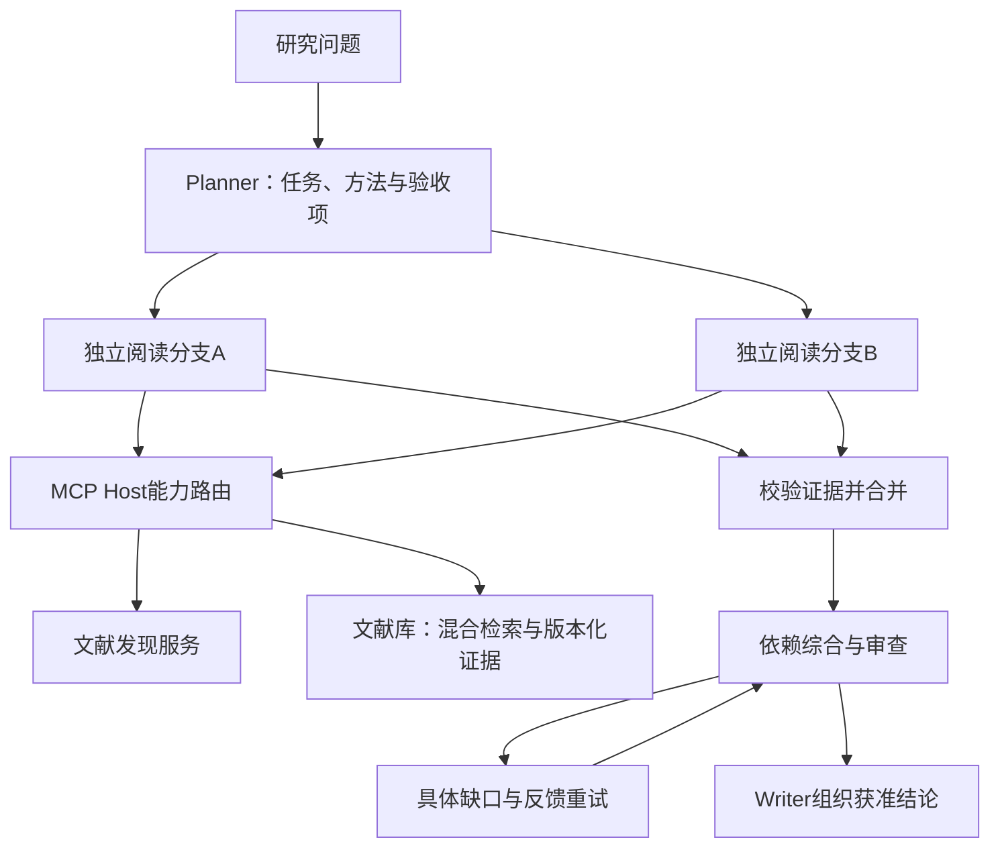
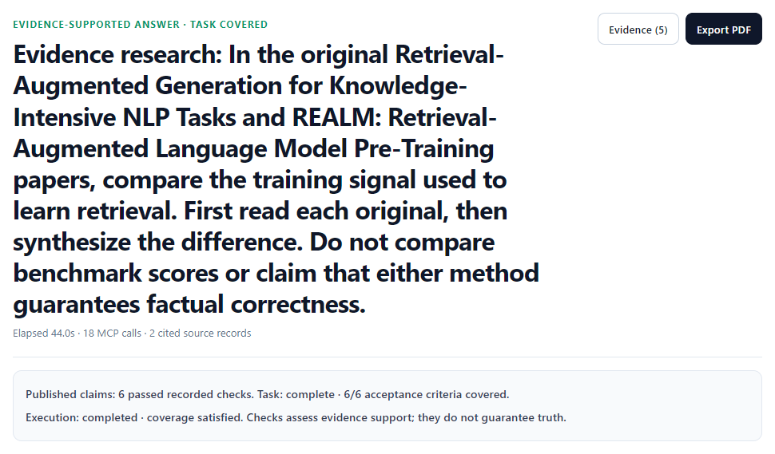
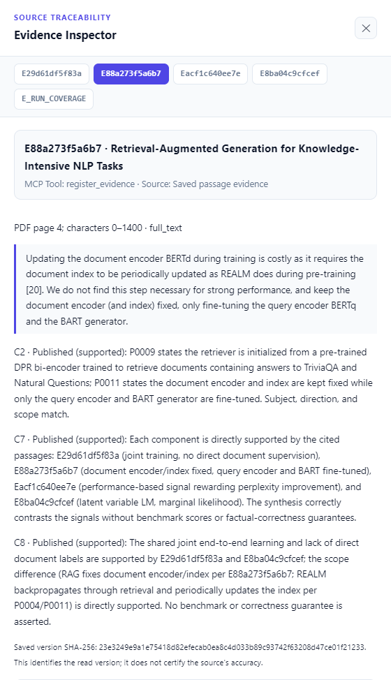
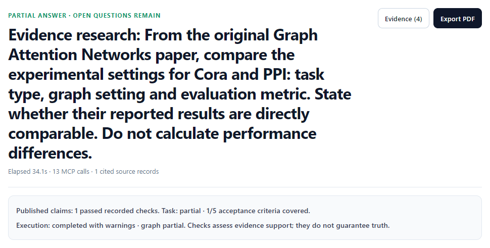
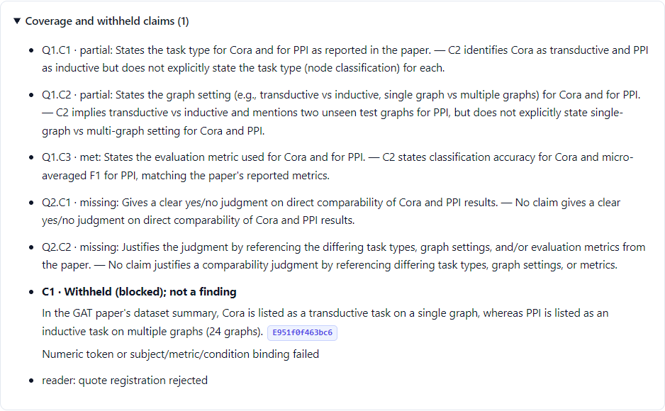

# 基于MCP、可组合Skills与混合检索的文献研究助手

## 摘要

本项目面向需要阅读和比较公开论文的使用者，构建一个训练无关的有界文献研究助手。系统通过模型上下文协议（Model Context Protocol，MCP）连接文献发现与证据处理服务，以Agent Skills组织角色和研究方法，并使用检索增强生成（Retrieval-Augmented Generation，RAG）选择原文上下文。研究过程采用有依赖任务图，支持独立阅读、证据合并、综合审查与缺口补查。71项本地及独立环境测试通过，真实跨论文任务完成。现有结果支持组件可用性与过程可追溯性；复杂比较、语义审查和普遍性能优势仍有待进一步验证。

**关键词：**MCP；Agent Skills；RAG；文献研究；任务图；证据核验

## 1 引言（Introduction）

### 1.1 应用场景与问题

研究者和学生比较两种论文方法时，通常需要定位原始文献、找到相关段落、判断实验或训练条件能否对齐，再形成带引用的解释。例如，比较RAG与REALM如何学习检索，需要区分预训练与微调、查询编码器与文档编码器，以及是否存在直接文档监督。搜索到相似关键词并不意味着这些条件已经核对。

直接根据搜索摘要生成回答，难以确认某一说法是否来自可读原文，也容易将不同条件下的描述拼成不恰当的对比。本项目将研究过程组织为“问题—任务—原文—证据—结论”，使来源、审查和未完成项能够被检查。

### 1.2 目标与范围

应用接收范围明确的论文事实查询、方法比较或证据整理问题，输出获准结论、精确引用、逐项覆盖情况和未解决内容。系统直接使用既有语言与检索模型，不进行额外训练或微调；重点实现能力分层、方法组合、原文检索及可追溯执行，不承诺任意领域的检索完整性或答案正确性。

## 2 方法（Method）

### 2.1 任务定义与总体流程

给定问题q，Planner生成最多三个子任务、验收项及无环依赖。阅读分支取得可访问原文，通过RAG选取上下文，提出证据e和候选结论c。结论满足引文、数值、访问级别和语义检查后才可发布。依赖任务使用获准证据综合，发现缺口后定向搜索、重读或修正综合。

**图1 系统流程。** 独立分支取得证据后汇合；综合结论仍需审查，不能因前置结论已通过就自动发布。

### 2.2 技术选择及设计依据

| 选择 | 对应问题 | 设计依据 |
|---|---|---|
| MCP能力分层 | 发现与证据处理耦合，替换服务牵涉研究逻辑 | 用统一调用接口和能力映射连接不同职责，候选与证据由Host交接 |
| 角色＋方法型Skills | 角色职责固定，具体研究程序难以扩展 | 保留阶段边界，将原始论文阅读、反证和比较程序按任务加载 |
| 原文RAG | 问题表达与论文措辞不同，摘要不足以支持细节 | 将语义召回与词项匹配结合，再向模型提供原文及邻段 |
| 有依赖任务图 | 多篇论文需要分别阅读，综合需等待前置证据 | 使用独立分支隔离上下文与状态，按依赖组织汇合 |
| 程序与模型分层审查 | 引文存在不等于语义成立，模型也可能错误计算 | 程序检查位置和数字，Auditor判断条件与支持范围 |
| 默认融合、不默认重排 | 增加模型未必改善当前语料的检索 | 按已有诊断结果选择默认配置，保留重排用于对照 |

这些理由说明组件如何对应研究任务；效果仍需由实测判断，不能仅凭架构复杂度推断优势。

### 2.3 MCP能力与上下文访问

MCP用于统一工具和上下文资源访问[1]。本项目通过`mcp_servers.json`注册两类服务，Host发现工具的能力标识与参数Schema，校验调用并映射实际工具名，不修改协议本身。

| 服务 | 研究能力 |
|---|---|
| 文献发现 | `search_papers`、`search_datasets`、`search_encyclopedia` |
| 文献库与证据 | `read_source`、`search_passages`、`get_passages`、`register_evidence`、`inspect_dataset` |

另有`register_sources`、`import_branch`两个Host交接能力，不授权给研究Skills。发现服务不直接写入文献库；Host先登记候选，随后允许读取。审查通过MCP Resources获取固定版本，再选择证据段落与相邻上下文。

### 2.4 Skills组织

Agent Skills通过按需加载的指令和资源封装任务程序[2]。项目采用以下两层分工：

| 层次 | 单元 | 职责 |
|---|---|---|
| 角色 | Planner | 定义子任务、方法、依赖及验收项 |
| 角色 | Reader | 提取引文和候选结论，或提出多证据综合 |
| 角色 | Auditor | 在新上下文中检查支持程度、条件、冲突及覆盖 |
| 角色 | Writer | 组织获准结论ID，不自行补写事实或数字 |
| 方法 | `original-paper` | 指定原始论文的定位约束与原文阅读 |
| 方法 | `experiment-comparison` | 提取任务、数据集、指标和协议，检查可比性 |
| 方法 | `counterevidence` | 查找限制、失败条件及可能反驳结论的证据 |
| 方法 | `cross-paper-synthesis` | 使用前置证据形成跨论文综合 |

包内保存`SKILL.md`、输出Schema、项目自定义`runtime.json`及必要参考资料。运行器发现元信息后，按任务激活内容，继承角色约束并执行权限和输出检查。方法包须遵循当前研究输入与结论协议；它们不是独立训练的模型。

### 2.5 混合检索RAG

PDF最多读取前60页，文本保留页码或章节位置，规范化后切为最长1400字符的段落，最多保存500段。默认检索为：

1. BM25词项匹配，参数k1＝1.5、b＝0.75[7]。
2. 使用BGE-small英文模型生成384维向量，以归一化向量内积匹配[3]。
3. 分别取两路前24个候选，以RRF融合[4]：`score(p) = Σr 1 / (60 + rank_r(p))`；只对p出现的排名列表求和。
4. 返回前六段，补充最多六个相邻段落，供Reader提取证据。

可选`hybrid`模式通过FlashRank使用TinyBERT对融合候选前24段重排，最大输入长度384 token[5]。默认`hybrid-no-rerank`保留融合而不重排。检索分数仅用于排序，不代表结论置信度。

向量由FastEmbed在CPU生成[6]，以本地NumPy矩阵缓存；缓存绑定原文哈希、段落文本和模型准备记录。系统不依赖独立向量数据库或GPU，模型失败时记录实际降级配置。

### 2.6 证据、计算与发布

证据必须是保存段落中的连续原文，记录来源ID、段落ID、位置、字符偏移和版本哈希。错误ID、改写引文及仅有元数据的实质证据申请会被拒绝。哈希定位版本，不证明来源权威或内容真实。

数值检查要求主体、指标、数值、单位、条件及局部文本对应。差值、比值和相对变化由程序计算，保存输入与公式；零分母或条件不一致时拒绝计算。Auditor进一步判断语义范围和实验可比性；任务、数据集、指标或协议不同，不能直接判定结论矛盾。

多证据综合与计算结果均重新送审。未审查、部分支持和冲突未解决的结论保留在记录中，正式回答只组织获准结论。任务完成度、执行状态和结论检查分别记录。

## 3 实现（Implementation）

### 3.1 数据来源与语料范围

OpenAlex、Crossref和arXiv提供候选记录及公开阅读链接，实际可访问的PDF或HTML正文构成主要研究语料。摘要、元数据、百科和数据集有界样本单独标记访问级别，不能替代需要全文支持的结论。DOI为可选定位标识，不是通过凭证。

RAG索引按当前问题取得的原文构建，段落检索以单篇保存全文为范围，跨论文证据由任务图汇合。索引可以复用；项目没有预建全量Wikipedia向量库，也未使用这些语料训练模型。可选数据集工具仅提供公开字段与有限样本，不支持总体统计或性能推断。

### 3.2 组件与执行状态

| 组件 | 实现 |
|---|---|
| 交互入口 | `app.py`提供本地HTTP页面和事件流；`research_cli.py`提供命令行研究与恢复 |
| 能力层 | 两类MCP服务与Host路由，调用参数由JSON Schema检查 |
| 方法层 | `skills/`中的角色和方法包，由运行器按任务加载 |
| 检索层 | 公开原文解析、BM25、BGE-small、RRF及可选TinyBERT |
| 证据层 | 版本化正文、精确引文登记、数字与计算检查、分支合并校验 |
| 调度层 | 最多两路阅读分支、依赖综合、缺口反馈、尝试记录和恢复 |

默认语言模型为DeepSeek，使用新调用上下文分开阅读和审查。每条阅读分支分别建立两类MCP服务的连接和实例，拥有独立目录与预算。前置任务结束且具有获准证据后，依赖综合才可继续。

原始问题与验收项在补查中保持不变。恢复时保存旧状态，保留完成分支，并为未完成工作建立新尝试；当前动态调整主要针对搜索、重读和综合重试。

### 3.3 用户操作与记录

用户输入问题后提交研究，页面依次显示规划、读取、审查和整理。点击引用可查看原文、版本和关联结论；展开覆盖区域可查看缺口与扣留原因，结果支持PDF导出。新问题建立新研究，未完成任务可由命令行恢复。

`research-state.json`保存问题、任务图、候选结论、审查与结果；`tool-state.json`保存来源、原文版本及引文，`branches/`保存分支尝试。覆盖图描述研究过程，不表示方法性能排名。具体启动与操作见[启动与使用说明](03_启动与使用说明.md)。

## 4 演示（Demonstration）

### 4.1 主线问题与执行过程

主线案例比较原始RAG与REALM论文如何学习检索，明确排除性能分数比较和普遍事实性保证。输入为：

> In the original Retrieval-Augmented Generation for Knowledge-Intensive NLP Tasks and REALM: Retrieval-Augmented Language Model Pre-Training papers, compare the training signal used to learn retrieval. First read each original, then synthesize the difference. Do not compare benchmark scores or claim that either method guarantees factual correctness.

| 阶段 | 本次实际执行 | 可核对结果 |
|---|---|---|
| 规划 | Q1阅读RAG，Q2阅读REALM，Q3依赖两者综合 | 前两项选择`original-paper`，第三项选择`cross-paper-synthesis` |
| 并行阅读 | 两分支在第4.422秒启动，约第21.9秒均结束 | 分别取得原文，独立登记证据 |
| 原文检索 | 两篇正文执行语义与BM25融合 | 本次无降级警告，保留段落及版本 |
| 审查与汇合 | 四条原文证据支持直接事实；首轮综合C5、C6被扣留 | 原文证据重新校验后用于依赖综合 |
| 反馈修正 | 综合执行第二轮，C7、C8获准 | 修正比较范围，保留被扣留候选 |
| 发布 | 发布C1—C4、C7、C8，共六条结论 | 六项验收满足，任务状态`complete` |

回答围绕原文中的训练设置展开：RAG微调时固定文档编码器和索引，更新查询编码器与生成器；REALM的相关预训练描述采用无监督文本信号，通过潜在检索文档的边际似然学习。综合需要同时说明共同机制及阶段条件，避免将“无直接文档监督”和“端到端学习”写成互斥关系。

本次耗时43.969秒，记录13次模型调用、18个研究动作、两个来源和8次MCP Resources读取。该时间属于单次运行，不构成稳定速度或加速比例。

### 4.2 界面与证据检查

以下截图以现有界面重现已保存的真实联网及DeepSeek运行结果，不代表本次重新执行模型。主线记录为`2ab9960e062246f3a93efbfad8309a73`，部分完成记录为`architecture-method-eae8acce`；截图未改写结论和状态。

**图2 跨论文主线的结果状态。** 页面显示两个引用来源、六条发布结论及6/6验收覆盖。Evidence中的五项包括四条原文证据和一条覆盖诊断记录，不表示五篇文献。

**图3 原文证据详情。** 选择`E88a273f5a6b7`可查看RAG论文PDF第4页的固定版本原文、关联结论和SHA-256。该证据说明文档编码器及索引保持固定、查询编码器与生成器被微调的适用条件；版本哈希不代表内容已获权威认证。

### 4.3 部分完成与缺口演示

另一个案例要求比较GAT论文中Cora与PPI的任务类型、图设置和评价指标，并判断结果能否直接比较。本次五项验收仅满足一项，发布一个结论，状态为`partial`。

**图4 部分完成状态。** 系统将已有获准内容与整体未完成状态分别展示，没有将一次正常结束等同于问题已完整回答。

**图5 验收缺口与扣留原因。** 未满足项涉及任务类型、图设置及可比性判断；候选C1因数值关系绑定未满足而被扣留，并保留引文登记失败警告。扣留表明当前证据链或检查条件未满足，不等于原论文中的对应事实必然错误。

该案例同时显示系统边界：研究可以取得来源和部分事实，但不一定形成完整比较。阶段记录使使用者能够定位缺口，而非仅看到生成后的文字。

## 5 讨论（Discussion）

### 5.1 设计适配性与验证依据

MCP的职责分层对应文献发现与证据处理的不同需求；方法包对应原始论文、反证和比较等研究程序；任务图对应先独立阅读、后综合的依赖关系。版本和引文检查使读者可以返回具体原文，语义审查与逐项覆盖则约束结论范围。

当前71项本地及独立环境测试通过，覆盖能力替换、契约、证据合并、并行隔离、依赖、预算和恢复。真实主线和网页操作验证了端到端路径；这些检查支持组件可用性与过程追溯，不是专家准确率评测。

检索诊断使用RAG、REALM、DPR、LoRA、Adam及GAT六篇论文的十二个手选目标问题。融合检索Hit@3为8/12，关键词基线为6/12；Hit@6均为10/12。TinyBERT重排Hit@6为7/12，因此默认不启用。目标标注不穷尽所有相关段落，不能当作回答准确率。

既有规则诊断另有十六个合成问题、六十四条候选结论，标签为编写时设定的预期。初版新架构的单题消融也未显示整体占优；后续同题完成包含多项修正，不能归因于某一模块。完整对照见[项目改进报告](01_改进报告.md)，语料与问题见[来源清单](../evaluation/retrieval_sources.json)及[诊断问题](../evaluation/retrieval_cases.json)。

### 5.2 局限与改进方向

当前为最多三个初始子任务的有界研究原型，不支持无限扩展研究目标。Reader和Auditor可使用同一模型，语义判断仍可能偏差；数字规则会保守扣留复杂表达。英文检索范围、公开正文可访问性及表格、公式和扫描件解析也限制了覆盖。

后续应围绕真实失败扩充独立人工标注，检查实验条件提取及数值误拦；在固定任务、预算和重复运行条件下比较方法包、检索和调度的效果。默认配置应根据验证结果调整，而不是预设增加组件必然提高质量。

本项目的贡献是将既有协议、模型和算法集成为可组合、可追溯的文献研究流程。现有证据支持功能与有限案例的实现，尚不足以宣称通用准确率、研究完整性或稳定性能优势。

## 参考文献

[1] Model Context Protocol. [Resources: Specification 2025-11-25](https://modelcontextprotocol.io/specification/2025-11-25/server/resources)[EB/OL].

[2] Agent Skills. [Agent Skills Overview](https://agentskills.io/home)[EB/OL].

[3] Beijing Academy of Artificial Intelligence. [BGE-small-en-v1.5 Model Card](https://huggingface.co/BAAI/bge-small-en-v1.5)[EB/OL].

[4] Cormack G V, Clarke C L A, Büttcher S. [Reciprocal Rank Fusion outperforms Condorcet and individual Rank Learning Methods](https://cormack.uwaterloo.ca/cormacksigir09-rrf.pdf)[C]//SIGIR. 2009: 758–759. DOI: 10.1145/1571941.1572114.

[5] Damodaran P. [FlashRank](https://github.com/PrithivirajDamodaran/FlashRank)[CP/OL].

[6] Qdrant. [FastEmbed](https://qdrant.tech/documentation/embeddings/fastembed/)[EB/OL].

[7] Robertson S, Zaragoza H. [The Probabilistic Relevance Framework: BM25 and Beyond](https://doi.org/10.1561/1500000019)[J]. Foundations and Trends in Information Retrieval, 2009. DOI: 10.1561/1500000019.
